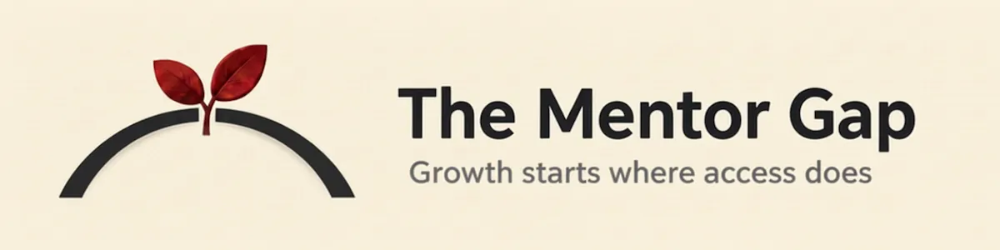

# The Mentor Gap

**Growth starts where access does**



Live site: [thementorgap.org](https://thementorgap.org/)

## About

A mentor changes the shape of someone's career, and most people who never get one simply never had access to someone who could guide them. The Mentor Gap works on that problem from both sides. It gives people who don't have access to a human mentor a free, structured way to build their own AI mentor. It also gives people who want to mentor but don't know how to start the confidence and tools to become capable mentors.

This is not a replacement for human mentorship. It's built for people who currently have none, on either side of the relationship.

The Mentor Gap is an independent, noncommercial initiative created by [Suzana Melo](https://linkedin.com/in/suzanamelo-m). Formal registration as a nonprofit association is planned as the project grows.

## What's inside

Free, self-serve guides. The walkthroughs use Claude.ai Projects (free plan), and the same approach works on ChatGPT Projects / Custom GPTs and Google Gemini Gems.

| Track                                 | For                                                   | Status                                                                                               |
| ------------------------------------- | ----------------------------------------------------- | ---------------------------------------------------------------------------------------------------- |
| **Virtual AI Mentor** (mentee track)  | People without access to a human mentor               | First guide live: _Setting Up Your AI Mentor_, online and as PDF in English and Brazilian Portuguese |
| **Mentor Starter Kit** (mentor track) | People who want to mentor but don't know how to start | Foundational guide planned for late 2026                                                             |

More guides and resources are released when they're ready.

## Tech stack

- [Hugo](https://gohugo.io/) with the [Blowfish](https://blowfish.page/) theme (included as a git submodule)
- Deployed on AWS Amplify (see `amplify.yml`)
- Analytics: [Umami](https://umami.is/), cookieless and privacy-focused (see the Privacy Commitment on the [About page](https://thementorgap.org/about/))

To run locally:

```bash
git clone --recurse-submodules https://github.com/thementorgap/thementorgap.git
cd thementorgap
hugo server
```

### Theme overrides

- `layouts/partials/home/background.html` overrides the Blowfish partial so the email link on the home page opens in the same tab instead of a blank new one. If you update the theme, check whether this file needs updating too.

## Repository structure

```
content/
  _index.md              home page
  about.md               About page
  virtual-ai-mentor/     Virtual AI Mentor guides (mentee track)
  mentor-starter-kit/    Mentor Starter Kit guides (mentor track)
static/
  downloads/             offline PDF versions of the guides
layouts/                 theme overrides (see above)
config/_default/         Hugo and Blowfish configuration
```

## Feedback and contact

- Guide feedback: use the anonymous feedback form at the end of each guide.
- Partnerships, translations, or problems with the site: [thementorgap.org@gmail.com](mailto:thementorgap.org@gmail.com)

## License

The site's code and configuration are licensed under MIT, see [LICENSE](LICENSE).

The guides and written content in `/content` are licensed under CC BY-NC-SA 4.0, see [LICENSE-CONTENT.md](LICENSE-CONTENT.md). Free to share and adapt, including translation, with attribution, for noncommercial use, under the same license.

## About the founder

Built by Suzana Melo, a full-stack engineer and AWS Community Builder who moved into tech in her 40s, after 20+ years in journalism and media leadership in Brazil. She founded the AWS Women's User Group Sweden, co-organizes the AWS User Groups Skåne and Manaus and AWS Community Day Baltic, and mentors career changers and women in tech through Women Innovating in Cloud Africa (WIICA) and Escola da Nuvem. She is studying for a postgraduate specialization in AI and Machine Learning at PUC Minas and writes about cloud, AWS, and AI for developers and career changers.

- [suzanamelo.com](https://suzanamelo.com/)
- [LinkedIn](https://linkedin.com/in/suzanamelo-m)
